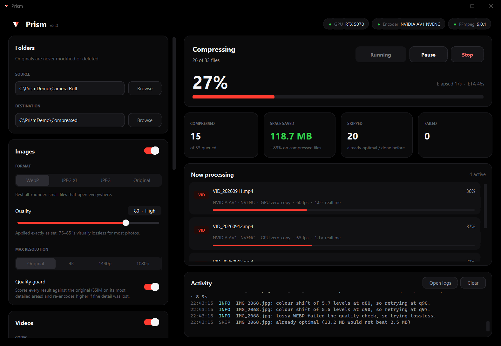
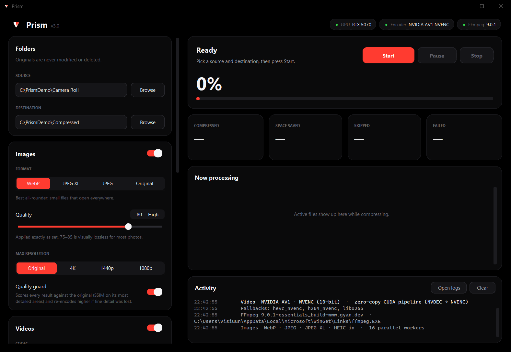
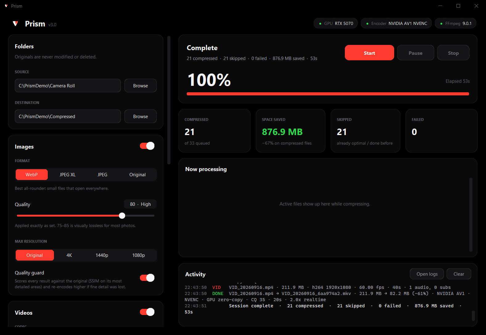
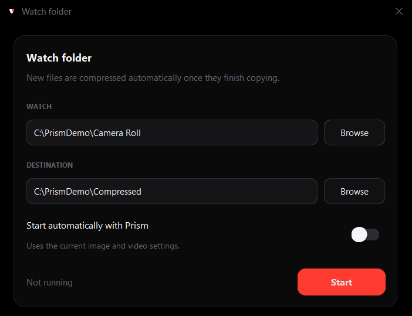

<div align="center">


# Prism

**Bulk image and video compressor that uses your GPU and checks its own work.**

Point it at a folder of photos and videos and get the same folder back at a fraction of the size, with original
colours, rotation, metadata, audio tracks and subtitles intact. Every result is verified before it is kept.

[](https://github.com/visiuun/Prism-Media-Compressor/releases/latest)
[](LICENSE)




</div>

## Contents

- [Quick start](#quick-start)
- [How to use](#how-to-use)
- [Examples](#examples)
- [Features](#features)
- [Screenshots](#screenshots)
- [Settings reference](#settings-reference)
- [How it works](#how-it-works)
- [Hardware and format support](#hardware-and-format-support)
- [Troubleshooting](#troubleshooting)
- [Building from source](#building-from-source)
- [License](#license)

## Quick start

### Windows: download and run

1. Download **`Prism.exe`** from the [latest release](https://github.com/visiuun/Prism-Media-Compressor/releases/latest).
2. Double-click it. Nothing to install.

If FFmpeg isn't already on your PC, Prism downloads it by itself on first launch (once).
Windows SmartScreen may warn because the exe isn't code-signed. Click **More info → Run anyway**.

### Any OS: run from source

```bash
git clone https://github.com/visiuun/Prism-Media-Compressor.git
cd Prism-Media-Compressor
```

| OS | Start Prism |
|---|---|
| Windows | double-click **`run.bat`** (installs Python with winget if you don't have it) |
| macOS / Linux | `./run.sh` |
| Anywhere | `python prism.py` |

The first launch installs every Python package it needs. If your system Python refuses pip installs
(Debian, Ubuntu, Homebrew and other PEP 668 setups), Prism creates a private `.venv` next to itself and
relaunches inside it. You never have to run `pip` yourself.

You only install these by hand if the first launch says they're missing:

- **Linux:** `sudo apt install python3-tk python3-venv` (Fedora: `python3-tkinter`, Arch: `tk`).
- **macOS:** `brew install python-tk` if your Python came from Homebrew.
- **FFmpeg:** Windows downloads it automatically, and macOS/Linux use a bundled build (`imageio-ffmpeg`).
  For hardware encoding on macOS/Linux, install your system's FFmpeg (`brew install ffmpeg`, `sudo apt install ffmpeg`).
  Prism picks it up automatically and prefers it.

## How to use

1. **Source:** the folder with your originals. Subfolders are included (toggle in *Behaviour*).
2. **Destination:** an empty or existing folder for the results. The folder structure is mirrored.
3. Choose image and video settings, or keep the defaults.
4. Press **Start**.

Your originals are never modified or deleted. Prism only writes to the destination, and only moves
originals if you turn on *Move originals to PROCESSED*.

While it runs you can **Pause**, which freezes every encoder process instantly, even mid-frame, and
**Resume** later. **Stop** discards anything half-written and keeps everything already finished.
On Windows, progress also shows on the taskbar icon.

**Re-runs are instant.** Prism remembers every file it has compressed (by content, not by name), so
running the same folder again only processes new or changed files. Files that couldn't get smaller
are remembered too, so they aren't retried at the same settings.

### Watch folder

**Behaviour → Watch folder** compresses new files automatically as they arrive in a folder, for
example a camera import, screenshot or download folder. Prism waits until each file has finished
copying before it touches it. Turn on *Start automatically with Prism* to resume watching on every launch.

## Examples

Starting points for common jobs. Everything not listed stays at its default.

| Goal | Images | Videos | Behaviour |
|---|---|---|---|
| **Shrink a phone camera roll** (default) | WebP · Quality 75 | Auto (AV1 on modern GPUs) · CQ 28 | Preserve metadata **on** |
| **Archive with no visible loss** | JPEG XL · Quality 90 | HEVC · CQ 22 | Quality guard **on**, Copy originals that can't shrink **on** |
| **Share or upload** (small, opens anywhere) | JPEG · Quality 80 · Max 1440p | H.264 · CQ 28 · Max 1080p | Preserve metadata **off** (strips GPS) |
| **Free up as much space as possible** | WebP · Quality 60 · Max 4K | AV1 · CQ 34 · Max 1080p · Limit to 30 fps | |
| **Screenshots and graphics** | Original (PNG stays lossless) or WebP | – | Prism switches to lossless automatically when it's smaller |
| **Old camcorder footage** (interlaced, AVI, MPEG) | – | HEVC · CQ 26 | Deinterlacing and timestamp repair happen automatically |

A few concrete cases:

- `IMG_2041.jpg`, a rotated portrait with GPS, becomes `IMG_2041_1a2b3c4d.webp`. It shows upright everywhere
  and keeps the GPS, camera EXIF and colour profile. The original is untouched.
- `VID_20260914.mp4` (1080p60 H.264 from a phone) becomes `VID_20260914_9f8e7d6c.mkv` in AV1 10-bit.
  Its audio is copied untouched if it's already efficient, and its chapters and subtitles are kept. The
  file is decoded end to end before it replaces anything.
- With content hashes turned off, `photo.jpg` and `photo.png` in the same folder still don't overwrite each other.
  They become `photo_jpg.webp` and `photo_png.webp`.

## Features

**Speed**
- **NVIDIA zero-copy pipeline.** Video is decoded on NVDEC, scaled and deinterlaced in VRAM (`scale_cuda`,
  `bwdif_cuda`) and encoded on NVENC without frames ever touching system RAM.
- **Every hardware encoder.** NVENC, AMD AMF, Intel Quick Sync and Apple VideoToolbox, with CPU fallback
  (SVT-AV1, x265, x264). Each is self-tested at startup and only working ones are offered.
- **Parallel everything.** Several videos at once on the GPU while every CPU core compresses images in separate
  processes. Fingerprinting is threaded and cached, so huge libraries re-scan in seconds.

**Accuracy**
- **Quality guard.** Each image is decoded and scored against the original with SSIM on its *most detailed*
  areas, where compression damage shows first. If fine detail was lost it re-encodes at higher quality,
  and it never keeps a result that fails the check.
- **Correct colours.** ICC profiles are kept, or converted to sRGB where a format can't carry them. CMYK,
  16-bit, greyscale and palette images are all handled properly.
- **Correct rotation.** EXIF orientation is applied to the pixels and reset in place, so the result displays
  upright everywhere without breaking the camera's maker notes.
- **Transparency and animation.** Alpha is preserved (JPEG falls back to WebP), and animated GIF/WebP/APNG
  keep every frame and its timing.
- **Lossless where it wins.** Screenshots and graphics are tried losslessly and kept that way when it's smaller.

**Reliability**
- **Nothing is ever lost.** Outputs are written to a temp file and only renamed into place after they pass
  verification. A result that isn't smaller than the original is discarded. Interrupted runs leave no partial files.
- **Videos are verified.** Duration, audio track count and a decode of the final seconds are checked before a
  video is accepted. A failing encoder automatically falls back to the next decode mode or encoder.
- **Everything survives.** All audio tracks, subtitles (text and image), attachments, chapters and metadata are carried over.
- **Crash-proof batches.** A corrupt file that crashes an image decoder restarts the worker pool and is retried.
  If it keeps crashing it's moved to `FAILED` and the batch continues.
- **History compatible.** It reads the history database of earlier Prism versions, so nothing gets recompressed.

**Comfort**
- Pure-black OLED interface with live per-file progress, FPS and speed, plus a colour-coded activity log.
- Pause, resume and stop at any moment. It can shut down when finished, and on Windows it keeps the PC awake while working.
- Daily log files, kept for 14 days (**Open logs**).

## Screenshots

| Ready | Finished |
|---|---|
|  |  |

<p align="center"></p>

## Settings reference

### Images

| Setting | What it does |
|---|---|
| **Format** | **WebP** is the best all-rounder. **JPEG XL** gives the smallest files at high quality, but check your viewers support it. **JPEG** has maximum compatibility. **Original** keeps each file's format (PNG stays lossless). |
| **Quality** (30–95) | Applied exactly as set. 75–85 is visually lossless for most photos. |
| **Max resolution** | Downscales the long edge to 4K / 1440p / 1080p. Smaller images are never upscaled. |
| **Quality guard** | SSIM check on the most detailed tiles, with an automatic re-encode if detail was lost. |

### Videos

| Setting | What it does |
|---|---|
| **Codec** | **Auto** picks the best your hardware can do (AV1 → HEVC → H.264, GPU before CPU). Output is always `.mkv`. |
| **Quality (CQ)** (18–40) | Constant quality: lower is better. 28 is the default, 22 is archival. Bitrate follows the content, with no caps. |
| **Max resolution** | 4K / 1440p / 1080p / 720p bound on the short edge, so portrait phone video is limited the same way as landscape. |
| **Limit to 30 fps** | Drops whole frames only (60→30, 50→25), so motion stays smooth. |
| **Parallel videos** | How many videos encode at once. Modern NVIDIA cards handle 2–4 comfortably. |

### Behaviour

| Setting | Default | What it does |
|---|---|---|
| Preserve metadata | on | EXIF, GPS, XMP, chapters and file dates. Colour profiles are always kept. |
| Scan subfolders | on | Recurse into subfolders and mirror them in the destination. |
| Add content hash to names | on | `photo_1a2b3c4d.webp`: unique names and safe re-runs. |
| Copy originals that can't shrink | off | So the destination always holds a complete set. |
| Move originals to PROCESSED | off | Moves each finished original into a `PROCESSED` subfolder next to it. |
| Move failures to FAILED | on | Moves files that couldn't be processed into `FAILED` for a look later. |
| Re-compress everything | off | Ignores history for this session only. |
| Shut down when finished | off | 60-second countdown you can cancel. |

## How it works

```
scan ──► fingerprint ──► plan ──► compress ──► verify ──► commit
         (cached)        skip:    images: CPU   SSIM /    temp file
                         history, processes     decode    renamed
                         dupes,   videos: GPU   check     into place
                         tiny     threads
```

- **Fingerprint.** SHA-1 of the file content (sampled for files over 50 MB), cached by path, size and mtime.
  Renaming or moving a file doesn't make Prism forget it.
- **Images.** Decode, apply orientation, normalise mode and colour, resize, then encode in memory. The quality
  guard scores the result and re-encodes up to two more times if needed. The smaller of lossless and lossy wins.
  The result is written only if it beats the original.
- **Videos.** Probe the streams with PyAV, plan scaling, frame rate and deinterlacing, and pick the decode mode
  (CUDA zero-copy, then NVDEC, then hardware auto, then software). Then run FFmpeg with a constant-quality encode,
  carry every stream over, and verify the output. On failure it retries without problem subtitles, with AAC
  instead of Opus, or with the next encoder.

Settings, history and logs live in `%APPDATA%\Prism` (Windows), `~/Library/Application Support/Prism`
(macOS) or `~/.config/Prism` (Linux). **Reset history** forgets which files were already compressed.

## Hardware and format support

| Encoder | Codecs | Notes |
|---|---|---|
| NVIDIA NVENC | AV1 (RTX 40/50), HEVC, H.264 | 10-bit, full zero-copy CUDA pipeline |
| AMD AMF | AV1 (RX 7000+), HEVC, H.264 | Windows |
| Intel Quick Sync | AV1 (Arc / Core Ultra), HEVC, H.264 | |
| Apple VideoToolbox | HEVC, H.264 | Constant quality needs Apple Silicon |
| CPU | SVT-AV1, x265, x264 | Always available as a fallback |

Encoders are detected and test-encoded at startup, so you only ever see ones that work on your machine.

**Image input:** JPEG, PNG, WebP, GIF, BMP, TIFF, HEIC/HEIF, AVIF, JPEG XL.
**Image output:** WebP, JPEG XL, JPEG, PNG, and animated WebP/GIF.
**Video input:** MP4, MKV, MOV, AVI, WebM, FLV, MTS/M2TS/TS, M4V, WMV, 3GP, MPEG.
**Video output:** MKV (AV1 / HEVC / H.264 with Opus, AAC or the original audio).

RAW camera files are skipped on purpose, because Pillow can only read their embedded preview.
Multi-page TIFFs are kept as-is so no pages are lost.

## Troubleshooting

| Problem | Fix |
|---|---|
| **FFmpeg chip says "missing"** | Windows: check your internet connection and restart Prism. macOS/Linux: `brew install ffmpeg` / `sudo apt install ffmpeg`. |
| **Encoder chip shows a CPU encoder on an NVIDIA PC** | Update your GPU driver. NVENC needs a driver at least as new as your FFmpeg build. |
| **"Tkinter is missing"** | Linux: `sudo apt install python3-tk`. macOS (Homebrew): `brew install python-tk`. |
| **A file was skipped as "already optimal"** | The compressed version wasn't smaller. Turn on *Copy originals that can't shrink* if you want it in the destination anyway. |
| **Want to redo everything** | Turn on *Re-compress everything* for one run, or press **Reset history**. |
| **macOS says the app is from an unidentified developer** | Right-click **Prism.app → Open**, or run `xattr -dr com.apple.quarantine Prism.app`. |

The full details of every run are in the log files (**Activity → Open logs**).

## Building from source

```bash
pip install -r requirements.txt pyinstaller
```

Windows:

```bat
pyinstaller --noconsole --onefile --name Prism --icon prism.ico --add-data "prism.ico;." --add-data "prism.png;." --collect-all customtkinter --collect-all pillow_jxl --collect-all pillow_heif prism.py
```

macOS / Linux (note `:` instead of `;`):

```bash
pyinstaller --windowed --onefile --name Prism --add-data "prism.ico:." --add-data "prism.png:." --collect-all customtkinter --collect-all pillow_jxl --collect-all pillow_heif --collect-all imageio_ffmpeg prism.py
```

Publishing a release runs [`.github/workflows/build.yml`](.github/workflows/build.yml), which builds the macOS and Linux versions and attaches them.

**Project layout**

| File | Purpose |
|---|---|
| `prism.py` | Entry point and first-run dependency installer |
| `prism_engine.py` | Everything that touches pixels, FFmpeg, hardware and the history database (no GUI) |
| `prism_ui.py` | The CustomTkinter interface |

## License

Prism is © 2026 [visiuun](https://github.com/visiuun) and licensed under
[**CC BY-NC 4.0**](LICENSE).

- ✅ Use, modify, fork and share it freely for any **non-commercial** purpose.
- ✅ **Credit is mandatory.** Name *"Prism by visiuun"*, link this repository and the license, and say if you changed it.
- ❌ **No commercial use.** No selling it, bundling it into paid products or services, or using it for monetary gain.

For commercial licensing, open an issue to get in touch.
